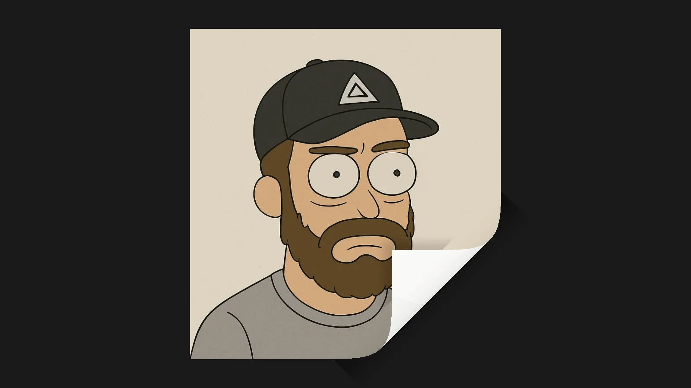

Paper Curl Scroll

Изображение, которое при прокрутке отгибается как лист бумаги из правого нижнего угла к левому верхнему, на Three.js, GSAP и Lenis.

[Смотреть](https://alexbulanovgooddevelopment.github.io/code_paper-curl-scroll/)

Запустите через локальный сервер (например, Live Server): модули и текстуры не работают при открытии файла напрямую.
